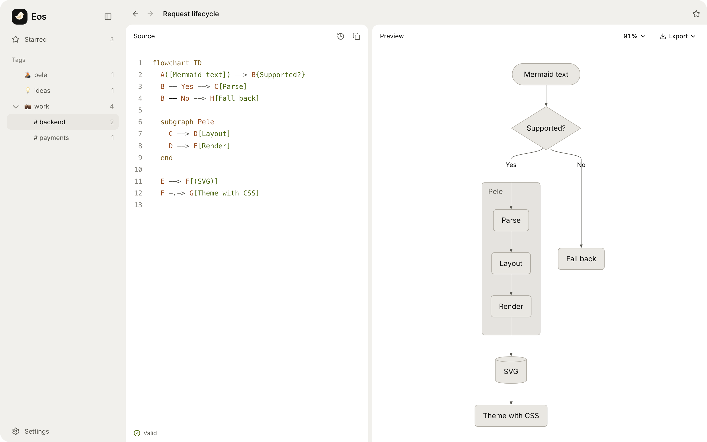

<p align="center">
  
</p>

<h1 align="center">Eos</h1>

<p align="center">A local-first Mermaid editor your agents can use too.</p>

<p align="center">
  <a href="https://eos.lil.run"><b>eos.lil.run</b></a>
</p>

<p align="center">
  <picture>
    <source media="(prefers-color-scheme: dark)" srcset="assets/editor-dark.png">
    
  </picture>
</p>

Write Mermaid, see it render instantly with [Pele](https://pele.run), and keep every diagram in your browser.
No account, no server. Tag and star diagrams, fuzzy-search them, roll back to any version, and share a
diagram as a link.

Every button in the app is also a [WebMCP](https://github.com/webmachinelearning/webmcp) tool, so an agent
in your browser can create, edit, organise and theme diagrams just like you. It asks before deleting anything.

<p align="center">
  <picture>
    <source media="(prefers-color-scheme: dark)" srcset="assets/home-dark.png">
    
  </picture>
</p>

## Use

Open [eos.lil.run](https://eos.lil.run). Diagrams are saved to IndexedDB as [Loro](https://loro.dev) CRDT
documents, sync across tabs and can be backed up from Settings.

## Develop

Needs Node 22.13+ and pnpm 12.

```sh
pnpm install
pnpm dev     # http://localhost:5173
pnpm test
```

## Deploy

Deploys to Cloudflare with the [`cf` CLI](https://developers.cloudflare.com/cf/).

```sh
pnpm --filter @eos/web exec cf auth login   # once
pnpm deploy
```

See [docs/data-model.md](docs/data-model.md) for how storage, history and the agent tools work.

## Credits

Built on [Pele](https://github.com/obsidianmd/pele), [Loro](https://loro.dev), [CodeMirror](https://codemirror.net),
[Orama](https://orama.com), [React Aria](https://react-aria.adobe.com) and [shadcn/ui](https://ui.shadcn.com). MIT licensed.
