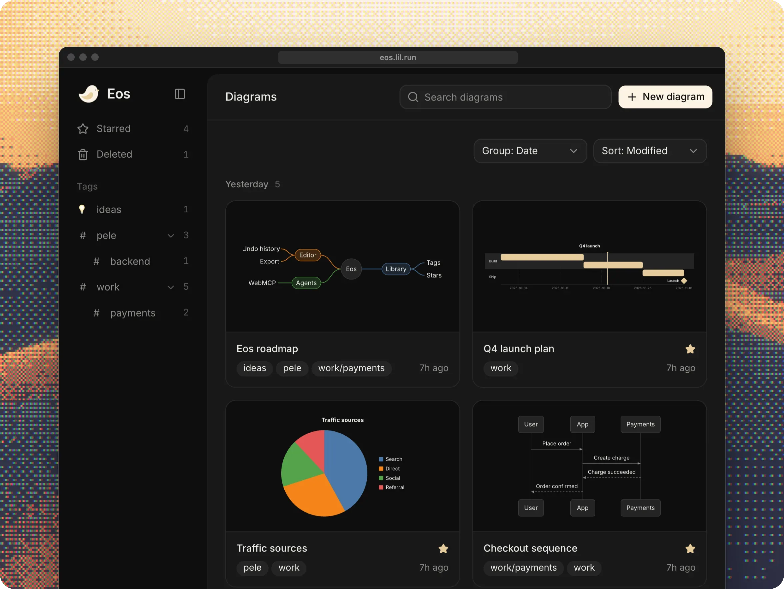
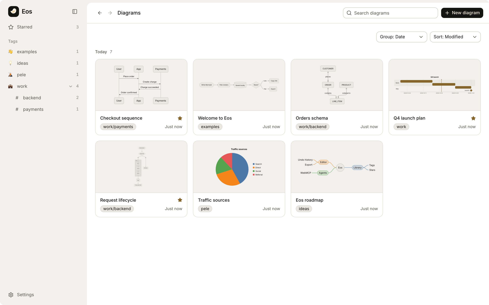

<p align="center">
  
</p>

<h1 align="center">Eos</h1>

<p align="center">A local-first Mermaid editor your agents can use too.</p>

<p align="center">
  <a href="https://eos.lil.run"><b>eos.lil.run</b></a>
</p>

<p align="center">
  
</p>

Write Mermaid and the preview updates as you type, rendered by [Pele](https://pele.run), a fast Mermaid
renderer. Every diagram stays in your browser, so you don't need an account. Organise diagrams with nested tags and stars, fuzzy-search them, roll back to any version, and share a
diagram as a link.

An agent in your browser can do anything you can in the app: create, edit, organise, theme and export
diagrams. Eos offers it a small set of tools through [WebMCP](https://github.com/webmachinelearning/webmcp),
a proposed browser standard that lets a page offer tools to AI agents. It asks before deleting anything.

<p align="center">
  <picture>
    <source media="(prefers-color-scheme: dark)" srcset="assets/home-dark.png">
    
  </picture>
</p>

## Use

Open [eos.lil.run](https://eos.lil.run). Your diagrams stay in this browser and are never uploaded. They're
stored with [Loro](https://loro.dev), so edits in one tab show up in your other open tabs. Export a backup from Settings.

Eos supports current Chrome and Edge, Firefox 147+ and Safari 26.2+.

## Develop

Needs Node 22.13+ and pnpm 12.

```sh
pnpm install
pnpm dev     # http://localhost:5173
pnpm test
```

See [docs/data-model.md](docs/data-model.md) for how storage, history and the agent tools work.

## Credits

Built on [Pele](https://github.com/obsidianmd/pele), [Loro](https://loro.dev), [CodeMirror](https://codemirror.net),
[Orama](https://orama.com), [React Aria](https://react-aria.adobe.com) and [shadcn/ui](https://ui.shadcn.com). MIT licensed.
