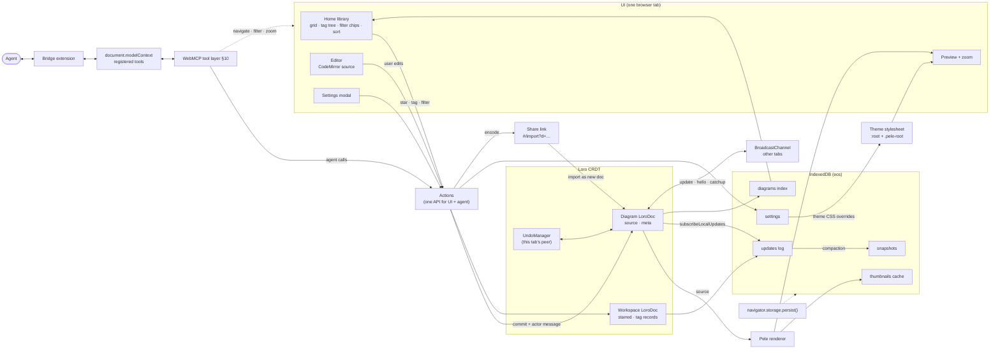

# Eos data model

Status: draft · Target: `loro-crdt@^1.16` (checked against 1.16.4 type defs and a node smoke test, 2026-10-18)

Eos is a local-first Mermaid editor. All diagrams stay in the browser: there is no server and no account. This doc covers how a diagram is represented (Loro), how it is stored (IndexedDB), how tabs and the WebMCP agent share edits, and how undo, history, and share links work.

## Goals

- **One source of truth per diagram:** a `LoroDoc`. Everything else (library index, thumbnails) is derived from it and can be rebuilt.
- **Edits never conflict.** The user, the in-tab WebMCP agent, and other open tabs all write to the same doc, and the CRDT merges them.
- **Undo is per tab.** ⌘Z reverts edits made in this tab, by the user or by the agent working in it, and never edits from another tab.
- **History is shared and attributed.** Every change records who made it (user, agent, or which tab), and the history panel shows that instead of using toasts.
- **The agent is a first-class editor.** Anything a person can do in the UI, an agent can do through WebMCP (§10), along the same code path.
- **Durable by default.** Request persistent storage once. There is no storage-management UI.

## Architecture



Agent edits and human edits both go through `Actions` into the same `LoroDoc`, so they merge, sync, get persisted, and show up in history the same way. The only difference is the actor recorded in the commit message (§3).

## 1. The diagram document

There is one `LoroDoc` per diagram. Its root containers:

| Root | Type | Contents |
| --- | --- | --- |
| `source` | `LoroText` | Mermaid source |
| `meta` | `LoroMap` | `title`, `tags`, `createdAt`, `schema` |

```ts
import { LoroDoc, LoroText, LoroMap, LoroList } from "loro-crdt";

type DiagramId = string; // nanoid, stable for the life of the diagram

/** Path-style tag, e.g. "work/backend". Segments are trimmed, lowercased, no empty segments. */
type TagPath = string;

interface DiagramMeta {
  title: string;
  tags: TagPath[];     // stored as a LoroList<string> under meta.tags
  createdAt: number;   // ms epoch; set once at creation
  schema: 1;           // doc schema version for future migrations
}

function sourceOf(doc: LoroDoc): LoroText { return doc.getText("source"); }
function metaOf(doc: LoroDoc): LoroMap { return doc.getMap("meta"); }
```

Notes:

- **Editor binding.** CodeMirror transactions map to `LoroText.insert/delete`. If a whole-buffer replacement comes from an external source, such as the agent's `set_source` tool or a paste-replace, use `text.update(newSource)`, which runs a minimal diff. That keeps concurrent edits elsewhere in the text intact.
- **Tags** go in a `LoroList<string>`, not a comma string. Concurrent add/remove of different tags then merges cleanly, and duplicates are de-duplicated on read.
- **`updatedAt` is not stored in the doc.** It is derived from the last change's timestamp (see §4) and cached in the index (§2).
- **Doc-level settings applied on every open:** `doc.setRecordTimestamp(true)`, so each `Change` carries a Unix timestamp in seconds, and the default `setChangeMergeInterval`. Consecutive local commits merge into one `Change` only if their messages match, so changes made by different actors stay separate (verified).

## 1a. The workspace document

Which tags a diagram has is a property of the diagram, so it travels with it in `meta.tags`, can be included in a share link, and shows up in that diagram's history. Being **starred**, and the **look of a tag** (its emoji and position in the sidebar), are personal library organisation, not diagram content. Those live in one workspace-level `LoroDoc`, stored under id `"workspace"` in the same `snapshots`/`updates` stores and synced over `eos:library`.

Reasons for keeping this in a separate doc:
- Starring a diagram should not bump its Modified time, appear in its history, or be undoable with ⌘Z in the editor.
- A tag's emoji belongs to the tag, not to any one diagram. Renaming a tag in one place should rename it everywhere.
- Using a CRDT, rather than a plain record like settings (§8), means a star in one tab and an emoji change in another both survive.

```ts
// Roots of the workspace doc
//   starred: LoroMap<DiagramId, number>   value = starredAt (ms); delete key to unstar
//   tags:    LoroMap<TagPath, LoroMap>    one entry per tag that has been customised
interface TagRecord {
  path: TagPath;     // map key, e.g. "work/backend"; parent is implied by the path
  emoji?: string;    // a single grapheme; missing → render "#"
  order?: string;    // fractional index among siblings; missing → alphabetical after ordered ones
}
```

- **Tag tree:** take the union of every tag in the index rows and every key in `workspace.tags`, split each on `/`, and nest. A tag with no diagrams stays in the tree only if it has a `TagRecord`. Otherwise it disappears when its last diagram drops it, the way it does in Bear.
- **Renaming or moving a tag** (`work/backend` → `eng/backend`): one commit per affected diagram doc rewrites that tag and every tag under it, with origin `"library:retag"`, so it is not on the user's undo stack. Then one workspace commit moves the `TagRecord` keys. These are not atomic across docs, so the rename is idempotent and resumes on the next open if it was interrupted.
- **Deleting a diagram** also removes its `starred` key.
- Edits to the workspace doc are committed with `{ actor: { kind: "user", tab } }` but have no UI history.

## 2. IndexedDB schema

Database `eos`, version 1. Use `idb` as a thin wrapper.

```ts
interface EosDB {
  /** Latest compacted snapshot per diagram. */
  snapshots: {
    key: DiagramId;
    value: { id: DiagramId; bytes: Uint8Array; vv: Uint8Array /* VersionVector.encode() */; savedAt: number };
  };
  /** Append-only log of updates since the snapshot. */
  updates: {
    key: number;                         // autoIncrement
    value: { id: DiagramId; bytes: Uint8Array; at: number };
    indexes: { byDiagram: DiagramId };
  };
  /** Denormalised rows for the library grid and tag tree. Rebuildable from snapshots+updates. */
  diagrams: {
    key: DiagramId;
    value: DiagramIndexRow;
    indexes: {
      byUpdatedAt: number; byCreatedAt: number; byTitleKey: string;
      byStarred: [0 | 1, number];  // [starred, updatedAt]
      byTag: TagPath;              // multiEntry over tagPrefixes
    };
  };
  /** Rendered library-card SVGs; a cache, safe to clear. */
  thumbnails: { key: DiagramId; value: ThumbnailRow };
  /** Singleton app settings. */
  settings: { key: "app"; value: AppSettings };
}

interface DiagramIndexRow {
  id: DiagramId;
  title: string;
  tags: TagPath[];
  /** Every prefix of every tag: "work/backend" → ["work", "work/backend"]. Backs the tag tree. */
  tagPrefixes: TagPath[];
  createdAt: number;
  updatedAt: number;      // ms; from last change timestamp
  titleKey: string;       // title folded for sorting (lowercased, NFKD, diacritics stripped)
  starred: 0 | 1;         // mirrored from workspace.starred; number because IDB can't index booleans
  sourcePreview: string;  // first ~200 chars, for search
  deletedAt?: number;     // soft delete → "Deleted"
}

interface ThumbnailRow {
  id: DiagramId;
  svg: string;            // Pele output, sanitised, theme vars left as var(--…)
  sourceHash: string;     // hash of the normalised source it was rendered from
  renderer: string;       // Pele version; a mismatch counts as a cache miss
}
```

### Write path

1. `doc.subscribeLocalUpdates(bytes => …)` fires after each local commit. Batch the update bytes and write them in one transaction about every 300 ms (and on `pagehide`). The same transaction appends each blob to `updates` and upserts the `diagrams` row.
2. Updates that arrive from other tabs (§5) are **not** persisted by the receiving tab. The tab that wrote them already did, so the log never holds duplicates. Importing an update twice is harmless anyway, because Loro dedupes by op id.

### Read path

```ts
async function openDiagram(id: DiagramId): Promise<LoroDoc> {
  const snap = await db.get("snapshots", id);
  const doc = snap ? LoroDoc.fromSnapshot(snap.bytes) : new LoroDoc();
  const logs = await db.getAllFromIndex("updates", "byDiagram", id);
  if (logs.length) doc.importBatch(logs.map(l => l.bytes)); // faster than N imports
  configureDoc(doc); // setRecordTimestamp, pre-commit hook (§4)
  return doc;
}
```

`LoroDoc.fromSnapshot`/`import` gives the opened doc a **fresh random peer id**. This is deliberate (see §3).

### Compaction

Compact a diagram when **any** of these is true:

- it has more than 200 log entries,
- the log for that diagram is over 512 KB,
- the doc is being closed, or the tab is going hidden (`visibilitychange`), and there have been more than 20 entries since the last compaction.

To compact, in one `readwrite` transaction over `snapshots` + `updates`:

```ts
const bytes = doc.export({ mode: "snapshot" });          // full history kept
const vv = doc.oplogVersion().encode();
await tx.objectStore("snapshots").put({ id, bytes, vv, savedAt: Date.now() });
// delete only the log rows the snapshot covers (keys <= lastKeyRead), so a concurrent
// write from another tab that landed after we read the log survives.
```

Two tabs may both compact. That is safe: each one deletes only the keys it read before taking its snapshot, and every snapshot contains all ops the tab has seen.

Full history is kept forever. We do not use `{ mode: "shallow-snapshot" }`, because Mermaid sources are small and history is a feature. If size becomes a problem, add an explicit "Trim history" action that exports `shallow-snapshot` at a chosen frontier (see Open questions).

### Library queries (filters + sort)

The sidebar has no "Recent" item; sorting replaces it. Clicking **Starred** or a tag adds a removable chip to the right pane (`★ Starred ×`, `#work/backend ×`). Chips combine with AND, and a **Sort by** dropdown (Modified / Created / Title) applies on top.

```ts
type LibrarySort = "modified" | "created" | "title";
interface LibraryQuery {
  starred: boolean;
  tags: TagPath[];      // each matches itself and its descendants
  sort: LibrarySort;    // modified/created: newest first; title: A→Z
}

function matches(row: DiagramIndexRow, q: LibraryQuery) {
  return !row.deletedAt
    && (!q.starred || row.starred === 1)
    && q.tags.every(t => row.tagPrefixes.includes(t));
}
```

**Strategy:** load every `diagrams` row into memory at startup (the rows are small now that thumbnails are stored separately: roughly 400 B each, about 2 MB at 5k diagrams). Filter and sort in JS, using `Intl.Collator` on `titleKey` for Title. Keep the in-memory copy current from local writes and from `eos:library` messages. At expected scale this takes well under a frame, and it avoids the IndexedDB limitation that blocks doing this in the database: a `multiEntry` index cannot be compound, so there is no `[tagPrefix, updatedAt]` index over an array field.

Indexes are still useful for the first paint, before every row has loaded, and for direct lookups:
- `byUpdatedAt`, `byCreatedAt`, `byTitleKey`: the first screen of an unfiltered grid comes from a cursor, and the rest streams in.
- `byStarred` on `[starred, updatedAt]` for the Starred chip.
- `byTag` (multiEntry over `tagPrefixes`): the key `"work"` returns everything under `work/*`.

**Fallback past ~20k diagrams:** add a `tagMembership` store with rows `{ prefix, id, updatedAt, createdAt, titleKey, starred }` and compound indexes `[prefix, updatedAt]` etc., one row per (diagram, tag prefix). Query the most selective chip through its index and filter the remaining chips in memory.

The last-used `sort` is saved in `settings.library.sort`. Chips are view state only and are reflected in the URL hash (`#/?tag=work/backend&starred=1`) so Back/Forward work.

**Rebuilding the index** (after a migration or corruption): open each diagram doc and the workspace doc, re-derive the rows, and rewrite `diagrams`.

### Thumbnails

Library cards are rendered live with Pele, but the rendered SVG is cached in `thumbnails`:
- A card shows the cached SVG at once if both `sourceHash` and `renderer` match. Otherwise it shows a skeleton and Pele renders the card when it scrolls into view (`IntersectionObserver`), at most 2 at a time, during idle time.
- Theme colours stay as CSS variables in the SVG, so changing the theme (§8) does not invalidate the cache.
- The cache is kept separate from `diagrams` so loading the whole index stays cheap. Rows for deleted diagrams are removed, and nothing else depends on the cache, so clearing it is always safe.

## 3. Peers and actors

**Peer id.** Loro's `PeerID` is a u64, exposed as a decimal string (`doc.peerIdStr`) or a bigint (`doc.peerId`). Two writers must never share a peer id. Eos therefore keeps the random id Loro assigns to each `LoroDoc` instance, so every tab opening a diagram has its own peer. It never calls `setPeerId` with a persisted value, because two tabs restoring the same stored id would corrupt the doc.

**Actor.** "Peer" is a Loro concept. "Actor" is the Eos concept shown in history:

```ts
type Actor =
  | { kind: "user"; tab: TabId }
  | { kind: "agent"; tab: TabId; tool: string; client?: string } // WebMCP tool name, optional agent label
  | { kind: "import"; source: "share-link" | "file" }
  | { kind: "system"; reason: "migration" | "undo" | "redo" | "restore" };

type TabId = string; // random per tab session, kept in sessionStorage; also used as BroadcastChannel sender id
```

The user and the agent share a tab, and therefore a peer, so the peer id alone cannot tell them apart. Attribution is carried in the **commit message**, which is persisted and synced. The **origin** is used for local routing only, because Loro does not persist it:

| Writer | `commit({ origin })` | message `by` |
| --- | --- | --- |
| Editor keystrokes / UI | `"user"` | `user` |
| WebMCP tool call | `"agent:<tool>"` | `agent` |
| UndoManager undo/redo | `"undo"` / `"redo"` (set by Loro) | `system` |
| History "restore to here" | `"restore"` | `system` |

```ts
interface ChangeMessage { v: 1; actor: Actor; summary?: string } // JSON in Change.message

function configureDoc(doc: LoroDoc, tab: TabId) {
  doc.setRecordTimestamp(true);
  // Catch implicit commits (export/import/checkout also commit) so nothing is unattributed.
  doc.subscribePreCommit(({ changeMeta, origin, modifier }) => {
    if (changeMeta.message) return;
    modifier.setMessage(JSON.stringify(actorFromOrigin(origin, tab)));
  });
}

// WebMCP tool wrapper
function agentEdit(doc: LoroDoc, tool: string, fn: () => void, summary?: string) {
  undo.groupStart();
  fn();
  doc.commit({ origin: `agent:${tool}`, message: JSON.stringify({ v: 1, actor: { kind: "agent", tab, tool }, summary }) });
  undo.groupEnd();
}
```

## 4. Undo/redo and history

### Undo/redo (this tab: user + agent)

```ts
const undo = new UndoManager(doc, {
  mergeInterval: 500,                       // ms; keystrokes within 0.5 s are one step
  maxUndoSteps: 200,
  excludeOriginPrefixes: ["library:"],      // bulk retags (§1a) are not undo steps
  onPush: (isUndo, _range, _ev) => ({ value: null, cursors: [selectionCursor()] }),
  onPop:  (_isUndo, { cursors }) => restoreSelection(cursors),
});
```

- `UndoManager` only ever records the doc's own peer, so other tabs' edits are never on this tab's stack. Its steps are rebased over edits from other tabs, so undoing your line after another tab changed a different line leaves that other line in place (verified with an excluded origin, which Loro treats the same way).
- Agent edits **are** on the stack. `agentEdit()` wraps each tool call in `groupStart()`/`groupEnd()`, so one tool call is one step. ⌘Z after the agent's edit reverts that edit, the way it would for a collaborator working in the same editor. Steps are not tagged by actor, so the `undo` tool can also undo the user's last step. That is the same thing ⌘Z does.
- Use `groupStart()`/`groupEnd()` to make multi-step UI operations, such as "rename node everywhere", a single step.
- Undo stacks live in memory only and do not survive reloads. That matches what people expect from editors.
- While previewing history (`checkout`), call `undo.pause()`, then `resume()` after `checkoutToLatest()`, so previewing neither records steps nor clears the stack.

### Shared history

The history panel replaces toasts. It lists changes newest first, grouped into sessions of the same actor within 2 min.

```ts
interface HistoryEntry {
  id: { peer: `${number}`; counter: number };
  actor: Actor;       // parsed from Change.message; unknown/missing → { kind: "user", tab: "?" }
  at: number;         // Change.timestamp * 1000
  summary?: string;
  isThisTab: boolean; // actor.tab === myTab
}

function history(doc: LoroDoc): HistoryEntry[] {
  const out: HistoryEntry[] = [];
  for (const changes of doc.getAllChanges().values())
    for (const c of changes) out.push(toEntry(c));
  return out.sort((a, b) => b.at - a.at || 0);
}
```

For large docs, use `doc.travelChangeAncestors(doc.oplogFrontiers(), cb)` and stop early instead of materialising everything.

Panel actions:

| Action | Loro API | Effect |
| --- | --- | --- |
| Preview a version | `doc.checkout(frontiers)` → doc becomes detached, read-only | Renders the diagram at that point. "Back to latest" calls `doc.checkoutToLatest()`. |
| Restore to here | `doc.revertTo(frontiers)` + `commit({ origin: "restore" })` | Adds **new** ops that bring the state back. History is preserved and peers converge. |
| Revert one change | `doc.diff(before, after)` → invert → `applyDiff` (or a text-level inverse) | Undoes only that change (e.g. one agent edit). Behind a flag until the inversion is proven (see Open questions). |

Frontiers for a change are `[{ peer, counter: c.counter + c.length - 1 }]`.

While a tab is detached, imports from other tabs are buffered in the oplog and not applied (Loro behaviour). Show a "N new changes" pill in that state.

## 5. Cross-tab sync (BroadcastChannel)

Each open diagram uses one channel, `eos:doc:<id>`. Messages:

```ts
type SyncMsg =
  | { t: "update"; from: TabId; bytes: Uint8Array }                 // local update, already persisted
  | { t: "hello";  from: TabId; vv: Uint8Array }                    // on open: my oplogVersion().encode()
  | { t: "catchup"; from: TabId; to: TabId; bytes: Uint8Array }     // export({mode:"update", from: theirVV})
  | { t: "presence"; from: TabId; actor: "user" | "agent"; cursor?: Uint8Array } // optional, via EphemeralStore later
  | { t: "deleted"; from: TabId };                                  // diagram soft-deleted elsewhere
```

- When a local commit happens, `subscribeLocalUpdates(bytes)` first writes to IndexedDB (§2), **then** posts `update`. A tab that missed a broadcast can still recover from disk.
- When a tab receives `update`, it calls `doc.import(bytes)` and does not persist the bytes.
- When a tab opens, it loads from disk and posts `hello`. Any peer that is ahead replies `catchup` with `export({ mode: "update", from: VersionVector.decode(vv) })`. Duplicates from several responders are harmless.
- A separate `eos:library` channel broadcasts `{ t: "index", id }` whenever a `diagrams` row changes, so other tabs refresh their grid and tag tree.
- If an `import` returns a non-null `ImportStatus.pending` (missing dependencies), the tab sends `hello` again to request a catch-up.

## 6. Share links

A share link carries a **copy of the source**, not the CRDT history. Opening one creates a brand-new diagram with fresh history.

```
https://eos.app/#/import?v=1&d=<base64url(deflate-raw(utf8(payload)))>
```

```ts
interface SharePayload { v: 1; title: string; source: string; tags?: TagPath[] }

async function encodeShare(p: SharePayload): Promise<string> {
  const raw = new TextEncoder().encode(JSON.stringify(p));
  const z = await new Response(new Blob([raw]).stream().pipeThrough(new CompressionStream("deflate-raw"))).arrayBuffer();
  return base64url(new Uint8Array(z)); // no padding; + → -, / → _
}
```

- The payload is in the **hash**, so it is never sent to a server or written to server logs.
- When Eos opens with `#/import`, it decodes the payload, validates it (size cap of 256 KB decompressed, schema check), and creates a new `DiagramId`. The `source`/`meta` writes are committed as `{ actor: { kind: "import", source: "share-link" } }`. Eos then persists the new diagram, navigates to it, and uses `history.replaceState` to clear the hash so a reload does not import again.
- If the source is identical to an existing diagram's (compared by hash of the normalised source), Eos offers "Open existing" instead of creating a duplicate.
- Links over ~8 KB are not reliably pasteable. Over that size, the export menu warns and offers "Download .mmd" instead.
- Tags are included only if the sharer opts in, because tags can leak how the sharer organises their work.

## 7. Storage persistence

```ts
async function ensurePersisted(): Promise<boolean> {
  if (!navigator.storage?.persist) return false;
  if (await navigator.storage.persisted()) return true;
  return navigator.storage.persist();
}
```

- Call `ensurePersisted()` once, after the first diagram is created. Browsers grant this more readily after user engagement (Firefox shows a prompt, while Chromium decides heuristically).
- Store the result in `settings.app.persist`. If the request was denied, show a one-line note in Settings (not a modal), for example "Browser may clear diagrams under storage pressure — export important ones." There is still no storage-management UI.

## 8. Settings record

Settings are not CRDT data. They are a single plain record, last-write-wins, and are broadcast on `eos:library` as `{ t: "settings" }`.

```ts
interface AppSettings {
  key: "app";
  schema: 1;
  theme: {
    mode: "system" | "light" | "dark";
    /** User CSS custom-property overrides applied to :root, e.g. { "--eos-node-fill": "#fef3c7" }. */
    overrides: Record<`--${string}`, string>;
    /** Optional raw CSS appended after overrides, scoped to the Pele renderer root. */
    customCss?: string;
  };
  persist: "granted" | "denied" | "unknown";
  lastOpenedId?: DiagramId;
  library: { sort: LibrarySort };
  agent: { webmcpEnabled: boolean };
}
```

Overrides are sanitised before use. Only `--*` keys are accepted. `customCss` is injected through a constructable stylesheet scoped to `.pele-root`, and anything containing `@import` or `url(` with a remote origin is rejected.

## 9. Lifecycle summary

| Event | Doc | IndexedDB | Broadcast |
| --- | --- | --- | --- |
| New diagram | `new LoroDoc()`, set meta, commit `user` | put snapshot + index row | `index` |
| Keystroke | `text.insert/delete` (auto-commit on debounce) | append `updates`; thumbnail invalidated by `sourceHash` | `update` |
| Agent tool | `agentEdit()` | append `updates` | `update` |
| Other tab edit | `import(bytes)` | — | — |
| Undo | `undo.undo()` | append `updates` | `update` |
| Restore version | `revertTo` + commit | append `updates` | `update` |
| Star / unstar | workspace `starred` set/delete | workspace `updates`; mirror `starred` in index row | `index` |
| Tag emoji / order | workspace `tags` entry | workspace `updates` | `index` |
| Delete | set `deletedAt` on index row; drop `starred` key | soft delete; purge after 30 days | `deleted`, `index` |
| Open share link | new doc from payload | snapshot + index row | `index` |

## 10. WebMCP tools

**Principle:** an agent can do anything a person can do in the UI. Every tool is a thin wrapper over the same `Actions` module the UI calls, so there is no separate agent-only path. The rules that follow from that:

- **Writes are attributed to the agent.** They commit with origin `agent:<tool>` and an `{ kind: "agent", tool }` actor message (§3), so they show up in history like any other change. The agent shares the tab's Loro peer; the commit message is what tells its edits apart from the user's.
- **Diagram writes are undoable.** Each tool call is wrapped in `undo.groupStart()`/`groupEnd()`, so it is exactly one step on the tab's undo stack. ⌘Z or the `undo` tool reverts it.
- **Library writes are reversed by the opposite call.** Stars, tags and settings are not on the undo stack. To reverse one, call its counterpart (e.g. `set_starred` with `false`).
- **Results include the new version.** Each write returns `{ ok: true, version }`, where `version` is the frontiers encoded as `"peer:counter,…"`.
- **Errors are typed.** Failures come back as `{ ok: false, code, message }`, with codes such as `not_found`, `invalid_input`, `parse_error`, `user_declined`, `disabled`, `stale`.
- **The user can turn it off.** If `settings.agent.webmcpEnabled` is false, no tools are registered.

```ts
type Id = DiagramId;
type VersionId = string; // encoded frontiers, from list_versions or a write result
interface Tool<I> { name: string; description: string; inputSchema: JSONSchema /* derived from I */; execute(i: I): Promise<unknown> }

const mc = (document as any).modelContext ?? (navigator as any).modelContext; // see Open questions
const reg = new AbortController();                 // abort() unregisters every tool
for (const t of tools) mc?.registerTool(t, { signal: reg.signal });
```

Key for the tables below: **R** reads only. **W** writes data. **V** changes only what the user is looking at. **⚠** waits for the user to confirm.

**Confirmation.** WebMCP has no user-confirmation API yet. For ⚠ tools, Eos opens its own in-page dialog ("The agent wants to delete *Checkout flow*. Allow / Deny"), and `execute` waits for the answer. If the user denies, the tool returns `user_declined`. A model cannot get past this step, because the dialog is part of the page, not something the tool's caller controls.

### Library

| Tool | Input | | Description |
| --- | --- | --- | --- |
| `list_diagrams` | `{ query?: string; starred?: boolean; tags?: TagPath[]; sort?: LibrarySort; includeDeleted?: boolean; limit?: number; cursor?: string }` | R | Same filter semantics as the chips (§2), plus full-text `query` over title and source preview. Returns index rows and `nextCursor`. |
| `get_diagram` | `{ id: Id }` | R | Meta, tags, starred, created/updated, current `version`, and source. |
| `list_tags` | `{}` | R | Tag tree with emoji, order and diagram counts. |

### Diagrams

| Tool | Input | | Description |
| --- | --- | --- | --- |
| `create_diagram` | `{ title?: string; source?: string; tags?: TagPath[]; open?: boolean }` | W | Creates a new doc. `open` defaults to true. Returns `id`. |
| `rename_diagram` | `{ id: Id; title: string }` | W | Sets `meta.title`. |
| `duplicate_diagram` | `{ id: Id; title?: string }` | W | New doc with the same source and tags, starting with fresh history. |
| `delete_diagram` | `{ id: Id }` | W ⚠ | Soft delete, moved to "Deleted". |
| `restore_diagram` | `{ id: Id }` | W | Undoes a soft delete. |

### Source

| Tool | Input | | Description |
| --- | --- | --- | --- |
| `get_source` | `{ id: Id; version?: VersionId }` | R | Source now, or at a past version (uses `forkAt`, so the live doc is not detached). |
| `set_source` | `{ id: Id; source: string }` | W | Replaces the whole source via `text.update()`, a minimal diff, so concurrent edits survive. |
| `patch_source` | `{ id: Id; edits: { line: number; endLine?: number; expect?: string; text: string }[] }` | W | Replaces 1-based line ranges, all in one commit. If any range no longer matches its `expect` text, nothing is applied and the tool returns `stale`. |
| `validate_source` | `{ id?: Id; source?: string }` | R | Parses the source with Pele's parser. Returns `{ ok, errors: { line, col, message }[] }`. |

### Rendering and export

| Tool | Input | | Description |
| --- | --- | --- | --- |
| `render_svg` | `{ id?: Id; source?: string; theme?: "current" \| "light" \| "dark" }` | R | Returns the SVG string, the same output as the preview. |
| `export_diagram` | `{ id: Id; format: "svg" \| "png" \| "mmd"; scale?: number; download?: boolean }` | R | Returns the file (PNG as base64). With `download: true`, it also saves the file through the browser, as the Export menu does. |
| `get_share_link` | `{ id: Id; includeTags?: boolean; copy?: boolean }` | R | Returns the §6 URL. `copy` writes it to the clipboard, which may fail when the tab has no recent user activation; the URL is returned either way. |
| `import_share_link` | `{ url: string; open?: boolean }` | W | Same as opening the link: creates a new diagram and returns `id` (or `existingId` for a duplicate). |

### History

| Tool | Input | | Description |
| --- | --- | --- | --- |
| `undo` / `redo` | `{ id: Id }` | W | The tab's `UndoManager`, same as ⌘Z / ⇧⌘Z. Returns `{ ok, canUndo, canRedo }`. |
| `list_versions` | `{ id: Id; limit?: number; actor?: Actor["kind"] }` | R | History entries (§4) with `VersionId`, actor, time, summary. |
| `preview_version` | `{ id: Id; version: VersionId \| "latest" }` | V | Opens the read-only history preview (`checkout`), or returns to latest. |
| `restore_version` | `{ id: Id; version: VersionId }` | W | `revertTo` as a new change, like "Restore to here". |

### Organisation

| Tool | Input | | Description |
| --- | --- | --- | --- |
| `set_starred` | `{ id: Id; starred: boolean }` | W | Workspace `starred` map. |
| `add_tags` / `remove_tags` | `{ id: Id; tags: TagPath[] }` | W | Edits `meta.tags`. Paths are normalised. |
| `rename_tag` | `{ from: TagPath; to: TagPath }` | W | Renames or moves a tag together with everything under it, across all diagrams (§1a). |
| `set_tag_style` | `{ path: TagPath; emoji?: string \| null; order?: string }` | W | `null` resets the emoji to `#`. |

### Navigation and view

| Tool | Input | | Description |
| --- | --- | --- | --- |
| `get_view` | `{}` | R | Current route, open diagram, filters, sort, zoom, editor selection, and whether a history preview is open. |
| `open_diagram` | `{ id: Id; line?: number }` | V | Opens the editor, optionally scrolled to a line. |
| `go_home` | `{}` | V | Library grid. |
| `set_library_view` | `{ starred?: boolean; tags?: TagPath[]; sort?: LibrarySort }` | V | Sets the chips and sort exactly as clicking would, URL hash included. |
| `set_zoom` | `{ action: "in" \| "out" \| "fit" \| "actual" }` | V | Preview zoom. |
| `open_settings` | `{ open: boolean }` | V | Shows or hides the Settings modal. |

### Settings and data

| Tool | Input | | Description |
| --- | --- | --- | --- |
| `get_settings` | `{}` | R | The `AppSettings` record (§8). |
| `set_theme` | `{ mode?: "system" \| "light" \| "dark"; overrides?: Record<string, string \| null>; customCss?: string \| null }` | W | Merges into the theme. `null` removes a key. Goes through the same sanitising as the UI. |
| `reset_theme` | `{}` | W | Clears overrides and `customCss`. |
| `get_storage_usage` | `{}` | R | `navigator.storage.estimate()`, `persisted()`, and diagram/byte counts. |
| `export_backup` | `{ download?: boolean }` | R | `.eos` backup: JSON `{ v: 1, settings, workspace, diagrams: { id, snapshot }[] }` with snapshots as base64. |
| `import_backup` | `{ data: string; mode: "merge" \| "replace" }` | W (⚠ for replace) | `merge` imports each snapshot into the matching doc, which is a CRDT merge and loses nothing. `replace` wipes local data first. |
| `delete_all_data` | `{}` | W ⚠ | Clears every store and unregisters the tabs. Not undoable. |

## Open questions

1. **Revert-one-change.** Inverting an arbitrary past change with concurrent edits on top is not a first-class Loro API (`revertTo` reverts to a *version*, not a single change). Should v1 ship only "restore to here"?
2. **History trimming.** Do we ever offer a shallow snapshot (`mode: "shallow-snapshot"`) to drop old history? If we do, links to old history entries break, and other tabs that hold a deeper history need a strategy for reconciling with it.
3. **Agent identity.** WebMCP may not tell us which agent or client is calling. Is `kind: "agent"` plus the tool name enough, or do we want the user to label sessions?
4. **Separate undo for user and agent.** Today the tab has one shared stack (§4). If users want "undo only my edits" while an agent works alongside them, the agent needs its own peer, for example a `doc.fork()` per agent session that merges back, with its own `UndoManager`.
5. **Multiple tag chips.** The default is AND (`#work` + `#q3` shows diagrams tagged with both). Do users expect OR between tags instead?
6. **Multi-device.** Out of scope for now. The snapshot + update-log layout can be synced as-is later, but if that happens, the `TabId`-based actor should become a device-plus-tab id.
7. **Starred in share links.** Never included for now. Should the recipient see the sender's tag emoji when tags are shared?
8. **WebMCP entry point.** The current explainer (webmachinelearning/webmcp) uses `document.modelContext.registerTool(tool, { signal })`. Earlier drafts and some Chrome builds used `navigator.modelContext` (`provideContext`/`registerTool`). We don't know which one Chrome 150 ships, so feature-detect both and keep the registration code in one module. Also unknown: whether a native confirmation or elicitation API will replace our in-page dialog, and whether annotations like `readOnlyHint` will be supported, which we would set for **R** tools.
