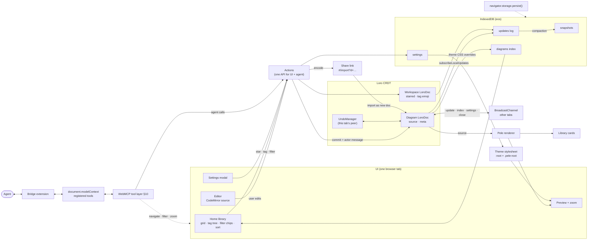

# Eos data model

Status: draft · Target: `loro-crdt@^1.16` (checked against 1.16.4 type defs and a node smoke test, 2026-10-18)

Eos is a local-first Mermaid editor. All diagrams stay in the browser: there is no server and no account. This doc covers how a diagram is represented (Loro), how it is stored (IndexedDB), how tabs and the WebMCP agent share edits, and how undo, history, and share links work.

## Goals

- **One source of truth per diagram:** a `LoroDoc`. Everything else (the library index) is derived from it and can be rebuilt.
- **Edits never conflict.** The user, the in-tab WebMCP agent, and other open tabs all write to the same doc, and the CRDT merges them.
- **Undo is per tab.** ⌘Z reverts edits made in this tab, by the user or by the agent working in it, and never edits from another tab.
- **History is shared and attributed.** Every change records who made it (user, agent, or which tab), and the history panel shows that instead of using toasts.
- **The agent is a first-class editor.** Anything a person can do in the UI, an agent can do through WebMCP (§10), along the same code path.
- **Durable by default.** Request persistent storage once. There is no storage-management UI.

## Architecture



Agent edits and human edits both go through `Actions` into the same `LoroDoc`, so they merge, sync, get persisted, and show up in history the same way. The only difference is the actor recorded in the commit message (§3).

## 1. The diagram document

There is one `LoroDoc` per diagram. Its root containers:

| Root     | Type       | Contents                               |
| -------- | ---------- | -------------------------------------- |
| `source` | `LoroText` | Mermaid source                         |
| `meta`   | `LoroMap`  | `title`, `tags`, `createdAt`, `schema` |

```ts
import { LoroDoc, LoroText, LoroMap, LoroList } from "loro-crdt"

type DiagramId = string // nanoid, stable for the life of the diagram

/** Path-style tag, e.g. "work/backend". Segments are trimmed, lowercased, no empty segments. */
type TagPath = string

interface DiagramMeta {
  title: string
  tags: TagPath[] // stored as a LoroList<string> under meta.tags
  createdAt: number // ms epoch; set once at creation
  schema: 1 // doc schema version for future migrations
}

function sourceOf(doc: LoroDoc): LoroText {
  return doc.getText("source")
}
function metaOf(doc: LoroDoc): LoroMap {
  return doc.getMap("meta")
}
```

Notes:

- **Editor binding.** CodeMirror transactions map to `LoroText.insert/delete`. If a whole-buffer replacement comes from an external source, such as an agent's `update_diagram({ source })` or a paste-replace, use `text.update(newSource)`, which runs a minimal diff. That keeps concurrent edits elsewhere in the text intact.
- **Tags** go in a `LoroList<string>`, not a comma string. Concurrent add/remove of different tags then merges cleanly, and duplicates are de-duplicated on read.
- **`updatedAt` is not stored in the doc.** It is derived from the last change's timestamp (see §4) and cached in the index (§2).
- **Doc-level settings applied on every open:** `doc.setRecordTimestamp(true)`, so each `Change` carries a Unix timestamp in seconds, and the default `setChangeMergeInterval`. Consecutive local commits merge into one `Change` only if their messages match, so changes made by different actors stay separate (verified).

## 1a. The workspace document

Which tags a diagram has is a property of the diagram, so it travels with it in `meta.tags`, can be included in a share link, and shows up in that diagram's history. Being **starred**, and a **tag's emoji**, are personal library organisation, not diagram content. Those live in one workspace-level `LoroDoc`, stored under id `"__workspace"` in the same `snapshots`/`updates` stores and synced over the `eos` channel (§5).

Reasons for keeping this in a separate doc:

- Starring a diagram should not bump its Modified time, appear in its history, or be undoable with ⌘Z in the editor.
- A tag's emoji belongs to the tag, not to any one diagram. Renaming a tag in one place should rename it everywhere.
- Using a CRDT, rather than a plain record like settings (§8), means a star in one tab and an emoji change in another both survive.

```ts
// Roots of the workspace doc
//   starred:  LoroMap<DiagramId, number>  value = starredAt (ms); delete key to unstar
//   tagEmoji: LoroMap<TagPath, string>    a single grapheme per tag that has one; missing → render "#"
```

- **Tag tree:** only tags in use. Take every tag prefix in the index rows of diagrams that aren't deleted, split on `/`, nest, and sort alphabetically, attaching each tag's emoji from `tagEmoji`. A tag disappears when its last diagram drops it, the way it does in Bear; its emoji stays in `tagEmoji` and comes back if the tag is used again.
- **Renaming or moving a tag** (`work/backend` → `eng/backend`): one commit per affected diagram doc rewrites that tag and every tag under it, with a `details:` origin so it is not on the user's undo stack. Then one workspace commit moves their `tagEmoji` keys; a tag merged into one that has its own emoji keeps that one. These are not atomic across docs, but the rename is idempotent, so running it again after an interruption finishes it.
- **Deleting a tag** removes it and every tag under it from each diagram, then drops their `tagEmoji` keys.
- **Deleting a diagram** keeps its `starred` key, so it's still starred if restored; purging it removes the key.
- Edits to the workspace doc are committed with `{ actor: { kind: "user", tab } }` but have no UI history.

## 2. IndexedDB schema

Database `eos`, version 1. Use `idb` as a thin wrapper.

```ts
interface EosDB {
  /** Latest compacted snapshot per diagram. */
  snapshots: {
    key: DiagramId
    value: { id: DiagramId; bytes: Uint8Array; savedAt: number }
  }
  /** Append-only log of updates since the snapshot. */
  updates: {
    key: number // autoIncrement
    value: { id: DiagramId; bytes: Uint8Array; at: number }
    indexes: { byDiagram: DiagramId }
  }
  /** Denormalised rows for the library grid and tag tree. Rebuildable from snapshots+updates. */
  diagrams: {
    key: DiagramId
    value: DiagramIndexRow
    indexes: {
      byUpdatedAt: number
      byCreatedAt: number
      byTitleKey: string
      byStarred: [0 | 1, number] // [starred, updatedAt]
      byTag: TagPath // multiEntry over tagPrefixes
    }
  }
  /** Singleton app settings. */
  settings: { key: "app"; value: AppSettings }
}

interface DiagramIndexRow {
  id: DiagramId
  title: string
  tags: TagPath[]
  /** Every prefix of every tag: "work/backend" → ["work", "work/backend"]. Backs the tag tree. */
  tagPrefixes: TagPath[]
  createdAt: number
  updatedAt: number // ms; from last change timestamp
  titleKey: string // title folded for sorting (lowercased, NFKD, diacritics stripped)
  starred: 0 | 1 // mirrored from workspace.starred; number because IDB can't index booleans
  sourcePreview: string // first ~200 chars
  sourceText: string // full source, for search (Orama, title boosted)
  deletedAt?: number // soft delete → "Deleted"
}
```

### Write path

1. `doc.subscribeLocalUpdates(bytes => …)` fires after each local commit, and each update is appended to `updates` as it comes, one write after another (`persistDoc` in `docs.ts`). If a write fails, the log is missing an update that every later one builds on, so the next write saves a full snapshot instead (see Compaction), or sooner on `pagehide` or when the tab is hidden. A diagram's queued writes are dropped when it is closed, which only a delete does.
2. The `diagrams` row is rewritten separately, after each change. While someone is typing it waits for a 300 ms pause, and a pending rewrite runs at once on `pagehide` or when the tab is hidden. A new diagram's snapshot and row are written in one transaction, so neither exists without the other.
3. Imported ops (a backup restored or merged) aren't local updates, so `subscribeLocalUpdates` never sees them. The import saves each doc it changes as a full snapshot and posts the imported bytes as an `update` (§5) itself.
4. Delete all clears the workspace doc's saved history along with everything else, so the change that unstars and drops tag emoji is saved as a full snapshot too. Logged on its own, it would build on history no longer on disk.
5. Updates that arrive from other tabs (§5) are **not** persisted by the receiving tab. The tab that wrote them already did, so the log never holds duplicates. Importing an update twice is harmless anyway, because Loro dedupes by op id.

### Read path

```ts
async function openDiagram(id: DiagramId): Promise<LoroDoc> {
  const snap = await db.get("snapshots", id)
  const doc = snap ? LoroDoc.fromSnapshot(snap.bytes) : new LoroDoc()
  const logs = await db.getAllFromIndex("updates", "byDiagram", id)
  if (logs.length) doc.importBatch(logs.map((l) => l.bytes)) // faster than N imports
  configureDoc(doc) // setRecordTimestamp, pre-commit hook (§4)
  return doc
}
```

`LoroDoc.fromSnapshot`/`import` gives the opened doc a **fresh random peer id**. This is deliberate (see §3).

### Compaction

Compact a diagram once its log has more than 200 entries, checked after each write (`persistDoc` in `docs.ts`). The same step saves a doc after a failed write, after an import and after Delete all (the workspace). Given an index row, it also writes that row, which is how a new diagram and an imported diagram that isn't open are saved.

To compact, in one `readwrite` transaction over `snapshots` + `updates` (+ `diagrams`, only when a row is given):

```ts
doc.importBatch([savedSnapshot, ...loggedUpdates]) // both read inside the transaction
await tx.objectStore("snapshots").put({ id, bytes: doc.export({ mode: "snapshot" }), savedAt: Date.now() }) // full history kept
// then delete the log rows read above
```

Two tabs may both compact. That is safe: the transaction makes the reads, the snapshot and the deletes atomic, and the snapshot holds everything already saved as well as everything the tab has seen. Another tab's change that hasn't arrived over the channel yet is taken in from disk instead of being dropped with the log.

Full history is kept forever. We do not use `{ mode: "shallow-snapshot" }`, because Mermaid sources are small and history is a feature. If size becomes a problem, add an explicit "Trim history" action that exports `shallow-snapshot` at a chosen frontier (see Open questions).

### Library queries (filters + sort)

The sidebar has no "Recent" item; sorting replaces it. Clicking **Starred** or a tag adds a removable chip to the right pane (`★ Starred ×`, `#work/backend ×`). Chips combine with AND, and a **Sort by** dropdown (Modified / Created / Title) applies on top.

```ts
type LibrarySort = "modified" | "created" | "title"
interface LibraryQuery {
  starred: boolean
  tags: TagPath[] // each matches itself and its descendants
  sort: LibrarySort // modified/created: newest first; title: A→Z
}

function matches(row: DiagramIndexRow, q: LibraryQuery) {
  return !row.deletedAt && (!q.starred || row.starred === 1) && q.tags.every((t) => row.tagPrefixes.includes(t))
}
```

**Strategy:** read every `diagrams` row for each query (roughly 400 B each plus the diagram source). Filter and sort in JS, comparing `titleKey` with `localeCompare` for Title. Queries rerun on local writes and on `index` messages from other tabs. At expected scale this takes well under a frame, and it avoids the IndexedDB limitation that blocks doing this in the database: a `multiEntry` index cannot be compound, so there is no `[tagPrefix, updatedAt]` index over an array field.

The `diagrams` store has two indexes:

- `byUpdatedAt`.
- `byTag` (multiEntry over `tagPrefixes`): the key `"work"` returns everything under `work/*`. Renaming or deleting a tag uses it to find the diagrams to change.

**Fallback past ~20k diagrams:** add a `tagMembership` store with rows `{ prefix, id, updatedAt, createdAt, titleKey, starred }` and compound indexes `[prefix, updatedAt]` etc., one row per (diagram, tag prefix). Query the most selective chip through its index and filter the remaining chips in memory.

Sort, grouping, search and chips are view state only and live in the URL hash (`#/?tag=work/backend&starred=1&sort=title`) so Back/Forward work.

**Rebuilding the index** (after a migration or corruption): open each diagram doc and the workspace doc, re-derive the rows, and rewrite `diagrams`.

### Thumbnails

Library cards render live with Pele. A typical diagram renders in well under a millisecond (about 2 ms for a 200-node flowchart), so there is no SVG cache.

## 3. Peers and actors

**Peer id.** Loro's `PeerID` is a u64, exposed as a decimal string (`doc.peerIdStr`) or a bigint (`doc.peerId`). Two writers must never share a peer id. Eos therefore keeps the random id Loro assigns to each `LoroDoc` instance, so every tab opening a diagram has its own peer. It never calls `setPeerId` with a persisted value, because two tabs restoring the same stored id would corrupt the doc.

**Actor.** "Peer" is a Loro concept. "Actor" is the Eos concept shown in history:

```ts
type Actor =
  | { kind: "user"; tab: TabId }
  | { kind: "agent"; tab: TabId; tool: string; client?: string } // WebMCP tool name, optional agent label
  | { kind: "import"; source: "share-link" | "file" }
  | { kind: "system"; reason: "migration" | "undo" | "redo" | "restore" }

type TabId = string // random per tab session, kept in sessionStorage; also used as BroadcastChannel sender id
```

The user and the agent share a tab, and therefore a peer, so the peer id alone cannot tell them apart. Attribution is carried in the **commit message**, which is persisted and synced. The **origin** is used for local routing only, because Loro does not persist it:

| Writer                    | `commit({ origin })`              | message `by` |
| ------------------------- | --------------------------------- | ------------ |
| Editor keystrokes / UI    | `"user"`                          | `user`       |
| WebMCP tool call          | `"agent:<tool>"`                  | `agent`      |
| UndoManager undo/redo     | `"undo"` / `"redo"` (set by Loro) | `system`     |
| History "restore to here" | `"restore"`                       | `system`     |

```ts
interface ChangeMessage {
  v: 1
  actor: Actor
  summary?: string
} // JSON in Change.message

function configureDoc(doc: LoroDoc, tab: TabId) {
  doc.setRecordTimestamp(true)
  // Catch implicit commits (export/import/checkout also commit) so nothing is unattributed.
  doc.subscribePreCommit(({ changeMeta, origin, modifier }) => {
    if (changeMeta.message) return
    modifier.setMessage(JSON.stringify(actorFromOrigin(origin, tab)))
  })
}

// WebMCP tool wrapper
function agentEdit(doc: LoroDoc, tool: string, fn: () => void, summary?: string) {
  undo.groupStart()
  fn()
  doc.commit({ origin: `agent:${tool}`, message: JSON.stringify({ v: 1, actor: { kind: "agent", tab, tool }, summary }) })
  undo.groupEnd()
}
```

## 4. Undo/redo and history

### Undo/redo: one stack for you, one for agents

Every commit carries its actor as the origin: `user`, `agent:<tool>`, `import` or `system` (§3). Each open diagram has two `UndoManager`s that filter on it:

```ts
const undo = new UndoManager(doc, { mergeInterval: 800, maxUndoSteps: 200, excludeOriginPrefixes: ["agent", "import", "system"] })
const agentUndo = new UndoManager(doc, { mergeInterval: 0, maxUndoSteps: 200, excludeOriginPrefixes: ["user", "import", "system"] })
```

- **⌘Z never undoes an agent.** Your stack skips agent commits; Loro rebases your steps over them, so undoing your line leaves the agent's lines in place. An agent's edit is reversed from history (restore an earlier version) or by the agent itself.
- **You and agents are equals.** Each has an undo stack of their own edits: your ⌘Z skips the agent's, and `update_diagram({ revert: "undo" })` (which uses `agentUndo`) skips yours, whoever edited last. Loro applies an undo on top of everyone's later edits, so neither overwrites the other. One ⌘Z undoes a whole burst of typing, even when another tab's edits arrived mid-burst.
- **Edits merge from what each side saw.** The editor sends each keystroke to Loro as an insert or delete, and an agent's new source is applied as the changes it made to the version it edited (`update_diagram`'s `baseVersion`: each tool result that returns source also returns the version that source is at, read with it), so concurrent edits from you, other tabs and agents all survive.
- **Undo commits are labelled too.** Before stepping, the store calls `doc.setNextCommitOptions({ origin, message })` with the actor doing the undo, so the commit an undo makes stays off the other stack and history credits the right person.
- **One write, one step.** Each store write wraps its change in `groupStart()`/`groupEnd()` on the actor's stack; `editDiagram` commits title and tags as details and the source as one undoable step.
- Undo stacks live in memory only and do not survive reloads.

### Shared history

The history panel replaces toasts. It lists changes newest first, grouped into sessions of the same actor within 2 min.

```ts
interface HistoryEntry {
  id: { peer: `${number}`; counter: number }
  actor: Actor // parsed from Change.message; unknown/missing → { kind: "user", tab: "?" }
  at: number // Change.timestamp * 1000
  summary?: string
  isThisTab: boolean // actor.tab === myTab
}

function history(doc: LoroDoc): HistoryEntry[] {
  const out: HistoryEntry[] = []
  for (const changes of doc.getAllChanges().values()) for (const c of changes) out.push(toEntry(c))
  return out.sort((a, b) => b.at - a.at || 0)
}
```

For large docs, use `doc.travelChangeAncestors(doc.oplogFrontiers(), cb)` and stop early instead of materialising everything.

Panel actions:

| Action            | Loro API                                                                   | Effect                                                                                                           |
| ----------------- | -------------------------------------------------------------------------- | ---------------------------------------------------------------------------------------------------------------- |
| Preview a version | `doc.checkout(frontiers)` → doc becomes detached, read-only                | Renders the diagram at that point. "Back to latest" calls `doc.checkoutToLatest()`.                              |
| Restore to here   | `doc.revertTo(frontiers)` + `commit({ origin: "restore" })`                | Adds **new** ops that bring the state back. History is preserved and peers converge.                             |
| Revert one change | `doc.diff(before, after)` → invert → `applyDiff` (or a text-level inverse) | Undoes only that change (e.g. one agent edit). Behind a flag until the inversion is proven (see Open questions). |

Frontiers for a change are `[{ peer, counter: c.counter + c.length - 1 }]`.

While a tab is detached, imports from other tabs are buffered in the oplog and not applied (Loro behaviour). Show a "N new changes" pill in that state.

## 5. Cross-tab sync (BroadcastChannel)

Every tab joins one channel, `eos`. Messages:

```ts
interface SyncMessage {
  type: "update" | "index" | "settings" | "close"
  id?: DiagramId
  bytes?: Uint8Array
}
```

- `update` (`id`, `bytes`): a local change to a diagram, or to the workspace doc (`id: "__workspace"`). `subscribeLocalUpdates(bytes)` posts it as the write to IndexedDB (§2) is queued; a backup import posts each doc's imported bytes once it has saved them. A receiving tab calls `doc.import(bytes)` if it has that doc open and does not persist the bytes; a tab without it open reads it from disk when it opens it.
- `index` (`id`): a `diagrams` row changed, so other tabs refresh their grid and tag tree.
- `settings`: settings changed; other tabs re-read them.
- `close` (`id?`): a diagram was purged, or with no `id` every diagram was deleted. Other tabs close their open copies so they stop saving edits to data that is gone.

## 6. Share links

A share link carries a **copy of the source**, not the CRDT history. Opening one creates a brand-new diagram with fresh history.

```
https://eos.app/#/import?v=1&d=<base64url(deflate-raw(utf8(payload)))>
```

```ts
interface SharePayload {
  v: 1
  title: string
  source: string
  tags?: TagPath[]
}

async function encodeShare(p: SharePayload): Promise<string> {
  const raw = new TextEncoder().encode(JSON.stringify(p))
  const z = await new Response(new Blob([raw]).stream().pipeThrough(new CompressionStream("deflate-raw"))).arrayBuffer()
  return base64url(new Uint8Array(z)) // no padding; + → -, / → _
}
```

- The payload is in the **hash**, so it is never sent to a server or written to server logs.
- When Eos opens with `#/import`, it decodes the payload, validates it (size cap of 256 KB decompressed, schema check), and creates a new `DiagramId`. The `source`/`meta` writes are committed as `{ actor: { kind: "import", source: "share-link" } }`. Eos then persists the new diagram, navigates to it, and uses `history.replaceState` to clear the hash so a reload does not import again.
- If the source is identical to an existing diagram's (compared by hash of the normalised source), Eos offers "Open existing" instead of creating a duplicate.
- Links over ~8 KB are not reliably pasteable. Over that size, the export menu warns and offers "Download .mmd" instead.
- Tags are included only if the sharer opts in, because tags can leak how the sharer organises their work.

## 7. Storage persistence

- `Eos.requestPersistence()` calls `navigator.storage.persist()`. The app calls it once per page load, on the first change to the library (`main.tsx`), whether made in this tab or heard from another. The sample diagrams are seeded before it starts listening, so they don't count. Browsers grant this more readily after user engagement (Firefox shows a prompt, while Chromium decides heuristically, and refuses early requests).
- The result isn't stored or shown anywhere. `Eos.storageUsage()` reports whether storage is persisted, but there is no storage-management UI.

## 8. Settings record

Settings are not CRDT data. They are a single plain record, last-write-wins, and are broadcast on `eos` as `{ type: "settings" }`.

```ts
interface AppSettings {
  key: "app"
  schema: 1
  theme: {
    mode: "system" | "light" | "dark"
    /** User CSS custom-property overrides applied to :root, e.g. { "--eos-node-fill": "#fef3c7" }. */
    overrides: Record<`--${string}`, string>
    /** Optional raw CSS appended after overrides, scoped to the Pele renderer root. */
    customCss?: string
  }
  lastOpenedId?: DiagramId
  library: { sort: LibrarySort }
  agent: { webmcpEnabled: boolean }
}
```

Overrides are sanitised before use. Only `--*` keys are accepted. `customCss` is injected through a constructable stylesheet scoped to `.pele-root`, and anything containing `@import` or `url(` with a remote origin is rejected.

## 9. Lifecycle summary

| Event           | Doc                                              | IndexedDB                                          | Broadcast |
| --------------- | ------------------------------------------------ | -------------------------------------------------- | --------- |
| New diagram     | `new LoroDoc()`, set meta, commit `user`         | put snapshot + index row                           | `index`   |
| Keystroke       | `text.insert/delete` (auto-commit on debounce)   | append `updates`                                   | `update`  |
| Agent tool      | `agentEdit()`                                    | append `updates`                                   | `update`  |
| Other tab edit  | `import(bytes)`                                  | —                                                  | —         |
| Undo            | `undo.undo()`                                    | append `updates`                                   | `update`  |
| Restore version | `revertTo` + commit                              | append `updates`                                   | `update`  |
| Star / unstar   | workspace `starred` set/delete                   | workspace `updates`; mirror `starred` in index row | `index`   |
| Tag emoji       | workspace `tagEmoji` entry                       | workspace `updates`                                | `index`   |
| Delete          | set `deletedAt` on index row; keep `starred` key | soft delete; purge from Deleted                    | `index`   |
| Purge           | close the doc; drop its `starred` key            | delete snapshot, `updates` and index row           | `close`   |
| Open share link | new doc from payload                             | snapshot + index row                               | `index`   |

## 10. WebMCP tools

**Principle:** an agent can do anything a person can do, through a small set of deep tools: one per kind of job, with optional fields rather than extra tools. Agents with tool search and code mode chain calls themselves, so fewer, clearer tools mean fewer wrong picks. Reads, ordinary writes and permanent deletes are separate tools because harnesses approve by annotations, which apply to a whole tool. Reads set `readOnlyHint` (and `untrustedContentHint` when they return people's text); permanent deletes set `consequentialHint`, which Chrome reads, and `destructiveHint`, MCP's name for it. Each tool's input is a Zod (`zod/mini`) schema: it becomes the JSON Schema agents see and checks every call, since browsers pass input through unchecked, so bad input returns `invalid_input` rather than throwing. The browser passes `execute` a `signal` that aborts when the agent cancels the call; a pending confirm then closes as a no.

- **Writes are attributed to the agent** (`{ kind: "agent", tool, changes }`), shown apart from yours in the History panel, and kept off your undo stack (§4).
- **Results are typed.** `{ ok: true, … }` or `{ ok: false, code, message }` with codes like `not_found`, `invalid_input`, `parse_error`, `stale`, `user_declined`, and `busy` when another dialog is already open, so nothing was asked.
- **Mermaid is always checked.** Tools that take or return source report `valid` and, on failure, the error's line and column.
- **Confirmation is in the page.** Deletes open Eos's own dialog and wait; a model can't get past it. Agents can read but not change agent settings, so they can't turn confirmation off.
- **Off switch.** With `settings.agent.webmcpEnabled` false, no tools are registered.

| Tool                                                                                                                          | Kind        | Does                                                                                                                                                                                                                                                                                             |
| ----------------------------------------------------------------------------------------------------------------------------- | ----------- | ------------------------------------------------------------------------------------------------------------------------------------------------------------------------------------------------------------------------------------------------------------------------------------------------ |
| `get_library({ query?, starred?, tags?, deleted?, sort? })`                                                                   | read        | Diagrams, the tag tree and counts.                                                                                                                                                                                                                                                               |
| `get_diagram({ id, version?, history? })`                                                                                     | read        | Title, tags, star, source (now or at a version) and the version it's at; `history` adds the version list.                                                                                                                                                                                        |
| `get_view()`                                                                                                                  | read        | Page, open diagram, filters, zoom, Settings open.                                                                                                                                                                                                                                                |
| `get_settings()`                                                                                                              | read        | Settings, the theme in effect with full CSS, storage used.                                                                                                                                                                                                                                       |
| `export({ format, id? \| source?, includeTags?, download? })`                                                                 | read        | `svg`, `png`, `mmd` (with its version), `link`, `backup`. Doubles as a dry-run parse check.                                                                                                                                                                                                      |
| `create_diagram({ title?, source?, tags?, starred?, fromShareLink?, open? })`                                                 | write       | New diagram, duplicate (from `get_diagram`'s source) or import a share link.                                                                                                                                                                                                                     |
| `update_diagram({ id, title?, source?, starred?, addTags?, removeTags?, revert?, deleted?, baseVersion?, expectedVersion? })` | write       | Every edit as one change. `revert`: `"undo"`, `"redo"` or a version id. `deleted: true` moves to Deleted (asks). `source` merges as changes from `baseVersion` (else replaces the text); the result returns the merged source if others' edits were kept. `expectedVersion` refuses stale edits. |
| `update_tag({ path, moveTo?, emoji? })`                                                                                       | write       | Rename or move a tag (including to the top level), set its icon.                                                                                                                                                                                                                                 |
| `set_view({ page?, diagramId?, filters?, previewVersion?, zoom?, settingsOpen? })`                                            | write       | Navigation and UI state.                                                                                                                                                                                                                                                                         |
| `set_theme({ mode?, appCss?, diagramCss? })`                                                                                  | write       | Theming.                                                                                                                                                                                                                                                                                         |
| `delete_tag({ path })`                                                                                                        | destructive | Remove a tag everywhere (asks).                                                                                                                                                                                                                                                                  |
| `import_backup({ data, mode })`                                                                                               | destructive | Merge, or replace (asks).                                                                                                                                                                                                                                                                        |
| `delete_all_data()`                                                                                                           | destructive | Wipe this browser's data (asks).                                                                                                                                                                                                                                                                 |

## Open questions

1. **Revert-one-change.** Inverting an arbitrary past change with concurrent edits on top is not a first-class Loro API (`revertTo` reverts to a _version_, not a single change). Should v1 ship only "restore to here"?
2. **History trimming.** Do we ever offer a shallow snapshot (`mode: "shallow-snapshot"`) to drop old history? If we do, links to old history entries break, and other tabs that hold a deeper history need a strategy for reconciling with it.
3. **Agent identity.** WebMCP may not tell us which agent or client is calling. Is `kind: "agent"` plus the tool name enough, or do we want the user to label sessions?
4. **Separate undo for user and agent.** Today the tab has one shared stack (§4). If users want "undo only my edits" while an agent works alongside them, the agent needs its own peer, for example a `doc.fork()` per agent session that merges back, with its own `UndoManager`.
5. **Multiple tag chips.** The default is AND (`#work` + `#q3` shows diagrams tagged with both). Do users expect OR between tags instead?
6. **Multi-device.** Out of scope for now. The snapshot + update-log layout can be synced as-is later, but if that happens, the `TabId`-based actor should become a device-plus-tab id.
7. **Starred in share links.** Never included for now. Should the recipient see the sender's tag emoji when tags are shared?
8. **WebMCP entry point.** The current explainer (webmachinelearning/webmcp) uses `document.modelContext.registerTool(tool, { signal })`. Earlier drafts and some Chrome builds used `navigator.modelContext` (`provideContext`/`registerTool`). We don't know which one Chrome 150 ships, so feature-detect both and keep the registration code in one module. Also unknown: whether a native confirmation or elicitation API will replace our in-page dialog, and whether annotations like `readOnlyHint` will be supported, which we would set for **R** tools.
