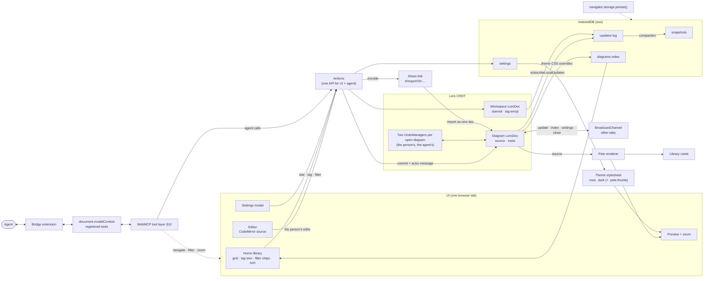

# Eos data model

Status: describes the code as built · Target: `loro-crdt@^1.16` (checked against 1.16.4 type defs and a node smoke test, 2026-10-20)

Eos is a local-first Mermaid editor. All diagrams stay in the browser: there is no server and no account. This doc covers how a diagram is represented (Loro), how it is stored (IndexedDB), how tabs and the WebMCP agent share edits, and how undo, history, and share links work.

## Goals

- **One source of truth per diagram:** a `LoroDoc`. Everything else (the library index) is derived from it and can be rebuilt.
- **Edits never conflict.** The person, the in-tab WebMCP agent, and other open tabs all write to the same doc, and the CRDT merges them.
- **Undo is per tab and per actor.** ⌘Z reverts the person's edits made in this tab, never an agent's and never another tab's. An agent has its own undo stack for its edits (§4).
- **History is shared and attributed.** Every change records who made it (the person, an agent, an import or the app), and the history menu shows that instead of using toasts.
- **The agent is a first-class editor.** Nearly anything a person can do in the UI, an agent can do through WebMCP (§10), along the same code path. The exception is Delete forever on chosen diagrams: an agent can only delete everything (§10).
- **Durable by default.** Request persistent storage once. There is no storage-management UI.

## Architecture



Agent edits and human edits both go through `Actions` into the same `LoroDoc`, so they merge, sync, get persisted, and show up in history the same way. The only difference is the actor recorded in the commit message (§3).

## 1. The diagram document

There is one `LoroDoc` per diagram. Its root containers:

| Root     | Type       | Contents                     |
| -------- | ---------- | ---------------------------- |
| `source` | `LoroText` | Mermaid source               |
| `meta`   | `LoroMap`  | `title`, `tags`, `createdAt` |

```ts
import { LoroDoc, LoroText, LoroMap, LoroList } from "loro-crdt"

type DiagramId = string // crypto.randomUUID(), stable for the life of the diagram

/** Path-style tag, e.g. "work/backend". A leading `#` is stripped, segments are trimmed and lowercased, whitespace inside becomes `-`, and empty segments are dropped. */
type TagPath = string

interface DiagramMeta {
  title: string
  tags: TagPath[] // stored as a LoroList<string> under meta.tags
  createdAt: number // ms epoch; set once at creation
}

// docs.ts reads them from an open diagram, whose `text` is doc.getText("source") and `meta` is doc.getMap("meta").
function sourceOf(d: { text: LoroText }): string
// Malformed fields read as their defaults (a backup can come from anywhere), and tags are deduplicated.
function metaOf(d: { meta: LoroMap }): DiagramMeta
```

Notes:

- **Editor binding.** CodeMirror transactions, a paste included, map to `LoroText.insert/delete`. A whole-buffer replacement from an external source, such as an agent's `update_diagram({ source })`, is applied as a diff by lines (`diffText` in `store.ts`): lines it keeps are left alone, lines it adds or removes go in or come out whole, between lines, and only lines it changes get a character diff (Loro's, as `text.update` makes it). That keeps concurrent edits elsewhere in the text intact, and whatever the person has typed on a line the agent kept stays on that line.
- **Line breaks.** The editor's only line break is `\n` (`EditorState.lineSeparator`), so it counts every other character, `\r` included, one for one with Loro: their positions always agree, whatever the text holds. A source coming into core (`createDiagram`, `editDiagram`, `setSource`, a share link) has its `\r\n` and lone `\r` made `\n`, and so does text pasted or dropped into the editor. A `\r` saved before that (by an older version, or in a backup, and so in a version a restore brings back) stays as it is: the editor shows it as a marker (␍), and Pele renders the source the same. A share link finds its existing copy with line breaks normalised on both sides.
- **Tags** go in a `LoroList<string>` under `meta.tags`. `setTags` edits the list in place (deleting tags no longer wanted, inserting missing ones), so concurrent tag edits merge. `normalizeTags` (`tags.ts`) de-duplicates on write and `metaOf` on read, since two sides adding the same tag leave it in the list twice.
- **`updatedAt` is not stored in the doc.** It is derived from the last change's timestamp (see §4) and cached in the index (§2).
- **Doc-level settings applied on every open:** `doc.setRecordTimestamp(true)`, so each `Change` carries a Unix timestamp in seconds, and `setChangeMergeInterval(0)` (both in `newDiagramDoc`, `docs.ts`). Loro's default would merge a peer's commits with the same message for up to 1,000 seconds, dating a later edit by an earlier one. Even at 0, Loro still merges commits with the same message made within the same second, which share a timestamp anyway; every other commit is its own `Change`. History does its own folding (§4).

## 1a. The workspace document

Which tags a diagram has is a property of the diagram, so it travels with it in `meta.tags`, can be included in a share link, and shows up in that diagram's history. Being **starred**, and a **tag's emoji**, are personal library organisation, not diagram content. Those live in one workspace-level `LoroDoc`, stored under id `"__workspace"` in the same `snapshots`/`updates` stores and synced over the `eos` channel (§5).

Reasons for keeping this in a separate doc:

- Starring a diagram should not bump its Modified time, appear in its history, or be undoable with ⌘Z in the editor.
- A tag's emoji belongs to the tag, not to any one diagram. Renaming a tag in one place should rename it everywhere.
- Using a CRDT, rather than a plain record like settings (§8), means a star in one tab and an emoji change in another both survive.

```ts
// Roots of the workspace doc
//   starred:  LoroMap<DiagramId, true>    a key per starred diagram; delete the key to unstar
//   tagEmoji: LoroMap<TagPath, string>    the icon text per tag that has one (not validated to a single grapheme); missing → render "#"
```

- **Tag tree:** only tags in use. Take every tag prefix in the index rows of diagrams that aren't deleted, split on `/`, nest, and sort alphabetically, attaching each tag's emoji from `tagEmoji`. A tag disappears when its last diagram drops it, the way it does in Bear; its emoji stays in `tagEmoji` and comes back if the tag is used again.
- **Renaming or moving a tag** (`work/backend` → `eng/backend`): one commit per affected diagram doc rewrites that tag and every tag under it, with a `details:` origin so it is not on the person's undo stack. Then one workspace commit moves their `tagEmoji` keys; a tag merged into one that has its own emoji keeps that one. These are not atomic across docs, but the rename is idempotent, so running it again after an interruption finishes it.
- **Deleting a tag** removes it and every tag under it from each diagram, then drops their `tagEmoji` keys.
- **Deleting a diagram** keeps its `starred` key, so it's still starred if restored; purging it removes the key, in a workspace commit made as the person.
- **`starred` is the only record of stars.** Index rows (§2) never store one: every read adds `starred` from this tab's workspace doc, as the tag tree adds emoji. So no row write can save a stale star, and starring writes no row and sends no `index` (§5).
- Edits to the workspace doc are committed like a diagram's, with the actor who made them as the commit message (§3): the person, an agent, or `system` for Delete all. Nothing shows the workspace doc's history.

## 2. IndexedDB schema

Database `eos`, version 3, opened through `idb` (`openEosDB` in `db.ts`). Version 1 also had a `thumbnails` store, which was never used; upgrading to 2 deletes it. Version 3 adds `pendingRows`.

```ts
interface EosDB {
  /** Latest compacted snapshot per diagram. */
  snapshots: {
    key: DiagramId
    value: { id: DiagramId; bytes: Uint8Array; savedAt: number }
  }
  /** Append-only log of updates since the snapshot. */
  updates: {
    key: number // autoIncrement
    value: { id: DiagramId; bytes: Uint8Array; at: number }
    indexes: { byDiagram: DiagramId }
  }
  /** Denormalised rows for the library grid and tag tree. Rebuildable from snapshots+updates. */
  diagrams: {
    key: DiagramId
    value: StoredRow
    indexes: {
      byUpdatedAt: number
      byTag: TagPath // multiEntry over tagPrefixes
    }
  }
  /** Diagrams whose `diagrams` row may be behind their doc: rebuilt on the next start (see Write path). */
  pendingRows: { key: DiagramId; value: { id: DiagramId } }
  /** Singleton app settings. */
  settings: { key: "app"; value: AppSettings }
}

// db.ts. A read adds `starred` to it, which makes it the DiagramIndexRow of types.ts.
interface StoredRow {
  id: DiagramId
  title: string
  tags: TagPath[]
  /** Every prefix of every tag: "work/backend" → ["work", "work/backend"]. Backs the tag tree. */
  tagPrefixes: TagPath[]
  createdAt: number
  updatedAt: number // ms; from last change timestamp
  titleKey: string // title folded for sorting (NFKD, diacritics stripped, lowercased)
  sourcePreview: string // first 200 characters
  sourceText?: string // full source, for search; missing on rows written before search used it
  deletedAt?: number // soft delete → "Deleted"
}
```

Reads (`listDiagrams`, `counts`, `getDiagram`, the starred filter) add `starred` to each row from `workspace.starred` (§1a), giving a `DiagramIndexRow`. Rows never store it; a `starred` field left in a row by an older version is ignored.

### Write path

1. `doc.subscribeLocalUpdates(bytes => …)` fires after each local commit, and each update is appended to `updates` as it comes, one write after another (`persistDoc` in `docs.ts`). If a write fails, the log is missing an update that every later one builds on, so the next write saves a full snapshot instead (see Compaction). It's also tried at once on `pagehide` or when the tab is hidden, though a write started then may never land. A diagram's queued writes are dropped when it is closed, which only a delete does.
2. The `diagrams` row is rewritten separately, after each change's write. While someone is typing it waits for a 300 ms pause, and a pending rewrite is tried at once on `pagehide` or when the tab is hidden. That may not land either, so each diagram update is written together with a `pendingRows` mark, in one transaction, and rewriting the row from the doc clears it. On start, Eos rebuilds the row of every marked diagram (`repairRows`), so a page that went away before rewriting a row leaves it behind only until the next start. A new diagram's snapshot and row are written in one transaction, so neither exists without the other.
3. Imported ops (a backup restored or merged) aren't local updates, so `subscribeLocalUpdates` never sees them. The import saves each doc it changes as a full snapshot and posts the imported bytes as an `update` (§5) itself.
4. Delete all clears the workspace doc's saved history along with everything else, so the change that unstars and drops tag emoji is saved as a full snapshot too. Logged on its own, it would build on history no longer on disk.
5. Updates that arrive from other tabs (§5) are **not** persisted by the receiving tab. The tab that wrote them already did, so the log never holds duplicates. Importing an update twice is harmless anyway, because Loro dedupes by op id.

### Read path

`loadDoc` in `docs.ts` makes a `new LoroDoc()`, turns on `setRecordTimestamp(true)`, imports the saved snapshot, then imports each logged update in order. The new doc has a **fresh random peer id**. This is deliberate (see §3).

### Compaction

Compact a diagram once its log has more than 200 entries, checked after each write (`persistDoc` in `docs.ts`). The same step saves a doc after a failed write, after an import and after Delete all (the workspace). Given an index row, it also writes that row, which is how a new diagram and an imported diagram that isn't open are saved.

To compact, in one `readwrite` transaction over `snapshots` + `updates` (+ `diagrams` and `pendingRows`, only when a row is given; it writes the row and clears that diagram's pending mark):

```ts
// both read inside the transaction; one at a time, since a batch that brings in new changes empties an open doc's undo stacks
if (savedSnapshot) doc.import(savedSnapshot.bytes)
for (const u of loggedUpdates) doc.import(u.bytes)
await tx.objectStore("snapshots").put({ id, bytes: doc.export({ mode: "snapshot" }), savedAt: Date.now() }) // full history kept
// then delete the log rows read above
```

Two tabs may both compact. That is safe: the transaction makes the reads, the snapshot and the deletes atomic, and the snapshot holds everything already saved as well as everything the tab has seen. Another tab's change that hasn't arrived over the channel yet is taken in from disk instead of being dropped with the log.

Full history is kept forever. We do not use `{ mode: "shallow-snapshot" }`, because Mermaid sources are small and history is a feature. If size becomes a problem, add an explicit "Trim history" action that exports `shallow-snapshot` at a chosen frontier (see Open questions).

### Library queries (filters + sort)

The sidebar has no "Recent" item; sorting replaces it. Clicking **Starred** or a tag in the sidebar shows that one filter as a removable chip (`★ Starred ×`, `#work/backend ×`); choosing another replaces it. A link or an agent's `set_view` can combine Starred with one tag. Search, Group and **Sort by** (Modified / Created / Title) apply on top, except that while searching the results are one list, best match first, with Sort only breaking ties; Group applies again once the search is cleared. The core query below accepts several tags, combined with AND, and `get_library` uses that; the library page uses at most one.

```ts
type LibrarySort = "modified" | "created" | "title"
interface LibraryQuery {
  starred: boolean
  tags: TagPath[] // each matches itself and its descendants
  sort: LibrarySort // modified/created: newest first; title: A→Z
}

function matches(row: DiagramIndexRow, q: LibraryQuery) {
  return !row.deletedAt && (!q.starred || isStarred(row.id)) && q.tags.every((t) => row.tagPrefixes.includes(t)) // isStarred reads workspace.starred
}
```

**Strategy:** read every `diagrams` row for each query (roughly 400 B each plus the diagram source). Filter and sort in JS, comparing `titleKey` with `localeCompare` for Title. Queries rerun on local writes and on `index` messages from other tabs. At expected scale this takes well under a frame, and it avoids the IndexedDB limitation that blocks doing this in the database: a `multiEntry` index cannot be compound, so there is no `[tagPrefix, updatedAt]` index over an array field.

The `diagrams` store has two indexes (`db.ts`):

- `byUpdatedAt`, over `updatedAt`. Nothing queries it today, since the library reads every row.
- `byTag` (multiEntry over `tagPrefixes`): the key `"work"` returns everything under `work/*`. Renaming or deleting a tag uses it to find the diagrams to change.

**Fallback past ~20k diagrams:** add a `tagMembership` store with rows `{ prefix, id, updatedAt, createdAt, titleKey }` and compound indexes `[prefix, updatedAt]` etc., one row per (diagram, tag prefix). Query the most selective chip through its index and filter the remaining chips in memory.

Sort, grouping, search and chips are view state only and live in the URL hash (`#/?tag=work/backend&starred=1&sort=title`) so Back/Forward work.

**Rebuilding the index** (after a migration or corruption): open each diagram doc, re-derive the rows, and rewrite `diagrams` (stars stay in the workspace doc).

### Library cards

Library cards render live with Pele. A typical diagram renders in well under a millisecond (about 2 ms for a 200-node flowchart), so there is no thumbnails store or SVG cache.

## 3. Peers and actors

**Peer id.** Loro's `PeerID` is a u64, exposed as a decimal string (`doc.peerIdStr`) or a bigint (`doc.peerId`). Two writers must never share a peer id. Eos therefore keeps the random id Loro assigns to each `LoroDoc` instance, so every tab opening a diagram has its own peer. It never calls `setPeerId` with a persisted value, because two tabs restoring the same stored id would corrupt the doc.

**Actor.** "Peer" is a Loro concept. "Actor" is the Eos concept shown in history (`types.ts`):

```ts
type Actor =
  | { kind: "user" }
  | { kind: "agent"; tool: string; changes?: string[] } // WebMCP tool name; what the edit touched, e.g. "source", "tags"
  | { kind: "import"; source: "share-link" | "backup" }
  | { kind: "system"; reason: string } // "seed" (the sample diagrams) or "delete-all"
```

The person and an agent share a tab, and therefore a peer, so the peer id alone cannot tell them apart. So every commit sets two things. Most go through `commit` in `docs.ts`; the editor's keystrokes and undo steps set them directly.

- The **message** is the actor as JSON, e.g. `{"kind":"agent","tool":"update_diagram","changes":["source"]}`. Loro persists and syncs it, so history reads it back. A missing or unreadable message (an old change, or a backup made elsewhere) reads as the person's.
- The **origin** routes the commit to an undo stack (§4). Loro does not persist it. It is `user`, `agent:<tool>`, `import` or `system`, with a `details:` prefix for title and tag changes. Keystrokes from the editor use `user:editor`, so the editor can skip its own changes.

An undo or redo step is labelled as whoever is undoing (§4), and restoring a version as whoever restored it. Nothing records which tab made a change.

## 4. Undo/redo and history

### Undo/redo: one stack for the person, one for agents

Every commit carries its actor as the origin (§3). Each open diagram has two `UndoManager`s that filter on it (`openDiagram` in `store.ts`):

```ts
const undo = new UndoManager(doc, {
  mergeInterval: 800,
  maxUndoSteps: 200,
  excludeOriginPrefixes: ["agent", "import", "system", "details:"],
})
const agentUndo = new UndoManager(doc, {
  mergeInterval: 0,
  maxUndoSteps: 200,
  excludeOriginPrefixes: ["user", "import", "system", "details:"],
})
```

Title and tag changes carry the `details:` prefix, so they are on neither stack. They are single values, so undoing one would overwrite whatever anyone set since. They still show in history.

- **⌘Z never undoes an agent.** The person's stack skips agent commits; Loro rebases their steps over them, so undoing their line leaves the agent's lines in place. An agent's edit is reversed from history (restore an earlier version) or by the agent itself.
- **The person and agents are equals.** Each has an undo stack of their own edits: the person's ⌘Z skips the agent's, and `update_diagram({ revert: "undo" })` (which uses `agentUndo`) skips the person's, whoever edited last. Loro applies an undo on top of everyone's later edits, so neither overwrites the other. One ⌘Z undoes a burst of typing only when nothing else landed during it: Loro ends an undo step at any change that isn't the person's, so typing interrupted by another tab or an agent takes several ⌘Z, each removing only the person's text.
- **Edits merge from what each side saw.** The editor sends each keystroke to Loro as an insert or delete, and an agent's new source is applied as the changes it made to the version it edited (`update_diagram`'s `baseVersion`: each tool result that returns source also returns the version that source is at, read with it), so concurrent edits from the person, other tabs and agents all survive.
- **Undo commits are labelled too.** Before stepping, the store calls `doc.setNextCommitOptions({ origin, message })` with the actor doing the undo, so the commit an undo makes stays off the other stack and history credits the right person.
- **One write, one step.** Each store write wraps its change in `groupStart()`/`groupEnd()` on the actor's stack; `editDiagram` commits title and tags as details and the source as one undoable step.
- Undo stacks live in memory only and do not survive reloads.

### Shared history

The history menu replaces toasts. `historyOf` in `docs.ts` builds it from `doc.getAllChanges()`, in causal (Lamport) order, and lists it newest first:

```ts
interface HistoryEntry {
  version: string // "<peer>:<counter>" of the entry's last change; pass it back to preview or restore
  actor: Actor // parsed from the commit message (§3)
  at: number // Change.timestamp * 1000
  changes?: string[] // for agent entries: everything those edits touched
}
```

Changes by the same actor less than 2 min apart fold into one entry. Agent edits fold together whichever tool made them, and never with the person's. The menu shows the latest 100 entries, and `get_diagram({ history: true })` up to 200.

- **Preview a version.** Picking an entry shows that version's source and diagram, read with `doc.forkAt(frontiers)` (`getSource` in `store.ts`). The open doc is never checked out, so it keeps taking in edits from other tabs while the person looks. An agent can open the same preview with `set_view({ previewVersion })`.
- **Restore this version.** `restoreVersion` calls `doc.revertTo(frontiers)` and commits it as an edit by whoever restored it. That adds new ops that bring the old state back, so other tabs converge. An agent restores with `update_diagram({ revert: version })`. Like any edit, a restore within 2 minutes of the same actor's last change folds into that change's history entry (`historyOf`), so the text from just before the restore is no longer reachable from history, and after a reload not by ⌘Z either. A restore to any version but the current one also empties the other actor's undo stack in that tab, whether or not it reverses any of their steps: an agent's `revert` to a version clears the person's ⌘Z there, and the person's Restore clears the agent's `revert: "undo"`.
- A version id the diagram doesn't have fails with `UnknownVersionError`, and nothing changes.
- Only a whole version can be restored. There is no "revert one change": Loro's `revertTo` goes back to a version, and inverting one past change under later edits has no Loro API.

## 5. Cross-tab sync (BroadcastChannel)

Every tab joins one channel, `eos`. Messages:

```ts
interface SyncMessage {
  type: "update" | "index" | "settings" | "close"
  id?: DiagramId
  ids?: DiagramId[]
  bytes?: Uint8Array
}
```

- `update` (`id`, `bytes`): a local change to a diagram, or to the workspace doc (`id: "__workspace"`). `subscribeLocalUpdates(bytes)` posts it once its write to IndexedDB (§2) has finished, or failed, so a tab that opens the doc from disk meanwhile can't miss it; a backup import posts each doc's imported bytes once it has saved them. A receiving tab calls `doc.import(bytes)` if it has that doc open and does not persist the bytes; a tab without it open reads it from disk when it opens it. A diagram's update doesn't refresh the library, whose row changes with the `index` that follows. The exception is a tab that has the diagram open: when the update changes its title or tags, that tab rebuilds the row from the merged doc and sends `index` itself, since the sender's row can lack a details change made there at the same time. The workspace's update does refresh the library (stars, tag emoji), and tells the views of each diagram whose star it changed (`diagram:<id>`, which the editor's Star button listens to). It writes no row: reads take stars from the workspace (§1a).
- `index` (`ids`): these `diagrams` rows changed, so other tabs refresh their grid and tag tree. A change to many diagrams (renaming a tag, a bulk delete, a backup import) sends one, listing them all. A star sends no `index`: the workspace's `update` refreshes the library.
- `settings`: settings changed; other tabs re-read them.
- `close` (`id?`): a diagram was purged, or with no `id` every diagram was deleted. Other tabs close their open copies so they stop saving edits to data that is gone.

## 6. Share links

A share link carries a **copy of the source**, not the CRDT history. Opening one creates a brand-new diagram with fresh history.

```
https://eos.lil.run/#/import?d=<base64url(deflate-raw(utf8(JSON payload)))>
```

```ts
// The JSON in the link is { v: 1, ...SharePayload }
interface SharePayload {
  title: string
  source: string
  tags?: TagPath[]
}
```

`encodeShare`, `decodeShare` and `shareUrl` live in `share.ts`, with the limits below.

- The payload is in the **hash**, so it is never sent to a server or written to server logs. The base64url has no padding.
- An encoded link may be up to 32,000 characters (`MAX_SHARE_HASH`). Past that, Copy share link shows "This diagram is too large to share as a link." instead of copying anything.
- When Eos opens with `#/import`, it decodes the payload and checks it: the link is at most 32,000 characters, it decompresses to at most 256 KB (stopping as soon as it passes that), `v` is 1, `source` is a string and the title is at most 1,000 characters. A missing title becomes "Shared diagram". A link that fails any check goes to the library, as a malformed one does.
- Otherwise `importShare` in `store.ts` creates the diagram, committed as `{ kind: "import", source: "share-link" }`, unless `findIdentical` finds one that isn't deleted with the same title and the same source. Then Eos opens that one instead, without asking. Either way it replaces the `#/import` URL with the diagram's, so a reload does not import again.
- The export menu puts only the title and source in a link. A link that carries `tags` gets them on import.

## 7. Storage persistence

- `Eos.requestPersistence()` calls `navigator.storage.persist()`. The app calls it once per page load, on the first change to the library (`main.tsx`), whether made in this tab or heard from another. The sample diagrams are seeded before it starts listening, so they don't count. Browsers grant this more readily once the person has used the page (Firefox shows a prompt, while Chromium decides heuristically, and refuses early requests).
- The result isn't stored or shown anywhere. `Eos.storageUsage()` reports whether storage is persisted, but there is no storage-management UI.

## 8. Settings record

Settings are not CRDT data. They are one plain record under the key `"app"` in the `settings` store, last-write-wins, and are broadcast on `eos` as `{ type: "settings" }`. `updateSettings` merges a patch into it section by section, and a record saved before a field existed is read with that field's default.

```ts
interface AppSettings {
  theme: {
    mode: "system" | "light" | "dark"
    /** CSS custom properties (the app's are --eos-*) applied to :root. null means the defaults. */
    customCss: string | null
    /** Diagram variables (--pele-*) applied to the renderer. null means the defaults. */
    diagramCss: string | null
  }
  agent: {
    /** Registers the WebMCP tools (§10). */
    webmcpEnabled: boolean
    /** Asks the person before an agent deletes anything. */
    confirmDestructive: boolean
  }
}
```

Theme CSS is sanitised before use: only custom-property declarations are kept (only `--pele-*` ones from `diagramCss`), and values that could load something (`url(`, `image-set(` and the like, or any backslash escape) are dropped, since the CSS can come from a backup or an agent.

Backups carry only the theme. Agent settings are the person's say over what agents may do, and agents can import backups, so a backup never changes them; ones an older backup carries are dropped on import. Before an import touches anything, every snapshot in the file is decoded, so a damaged file fails with the library intact. Diagrams from a backup can hold anything, so tags that aren't strings are dropped and a commit message that isn't an actor reads as the person's.

## 9. Lifecycle summary

| Event           | Doc                                              | IndexedDB                                | Broadcast          |
| --------------- | ------------------------------------------------ | ---------------------------------------- | ------------------ |
| New diagram     | `new LoroDoc()`, set meta, commit as its creator | put snapshot + index row                 | `index`            |
| Keystroke       | `text.insert/delete`, committed per edit         | append `updates`, mark `pendingRows`     | `update`           |
| Agent tool      | store write, committed as the agent (§3)         | append `updates`, mark `pendingRows`     | `update`           |
| Other tab edit  | `import(bytes)`                                  | —                                        | —                  |
| Undo            | `undo.undo()`                                    | append `updates`, mark `pendingRows`     | `update`           |
| Restore version | `revertTo` + commit                              | append `updates`, mark `pendingRows`     | `update`           |
| Star / unstar   | workspace `starred` set/delete                   | workspace `updates`                      | workspace `update` |
| Tag emoji       | workspace `tagEmoji` entry                       | workspace `updates`                      | workspace `update` |
| Delete          | — (keeps its `starred` key)                      | set `deletedAt` on the index row         | `index`            |
| Purge           | close the doc; drop its `starred` key            | delete snapshot, `updates` and index row | `close`            |
| Open share link | new doc from payload                             | snapshot + index row                     | `index`            |

## 10. WebMCP tools

**Principle:** an agent can do what a person can do, through a small set of deep tools: one per kind of job, with optional fields rather than extra tools. Agents with tool search and code mode chain calls themselves, so fewer, clearer tools mean fewer wrong picks. Reads, ordinary writes and permanent deletes are separate tools because harnesses approve by annotations, which apply to a whole tool. Reads set `readOnlyHint` (and `untrustedContentHint` when they return people's text); permanent deletes set `consequentialHint`, which Chrome reads, and `destructiveHint`, MCP's name for it. Each tool's input is a Zod (`zod/mini`) schema: it becomes the JSON Schema agents see and checks every call, since browsers pass input through unchecked, so bad input returns `invalid_input` rather than throwing. The browser passes `execute` a `signal` that aborts when the agent cancels the call; a pending confirm then closes as a no.

The exception: no tool permanently deletes chosen diagrams, as Delete forever in the selection bar does (`eos.purge`). An agent can move a diagram to Deleted (`update_diagram`) or wipe every diagram (`delete_all_data`), but not purge one. Agent settings aren't an exception, since the person has no UI for them either; agents can read them but not change them (below).

- **Writes are attributed to the agent** (`{ kind: "agent", tool, changes }`), shown apart from the person's in the history menu, and kept off the person's undo stack (§4). The exceptions: `create_diagram({ fromShareLink })` goes through `eos.importShare`, so the new diagram is attributed `{ kind: "import", source: "share-link" }`; `import_backup` keeps each diagram's own history and records its workspace changes as `{ kind: "import", source: "backup" }` (a replace's wipe as `{ kind: "system", reason: "delete-all" }`); and `delete_all_data` leaves no diagram history, only a workspace change recorded as `{ kind: "system", reason: "delete-all" }`.
- **Results are typed.** `{ ok: true, … }` or `{ ok: false, code, message }` with codes like `not_found`, `invalid_input`, `parse_error`, `stale`, `user_declined`, and `busy` when another dialog is already open, so nothing was asked.
- **Mermaid is always checked.** Tools that take or return source report `valid` and, on failure, the error's line and column. The exception is `export` with `format: "link"`, which returns only the link.
- **Confirmation is in the page.** Deletes open Eos's own dialog and wait; a model can't get past it. Agents can read but not change agent settings, so they can't turn confirmation off.
- **Off switch.** With `settings.agent.webmcpEnabled` false, no tools are registered.

| Tool                                                                                                                          | Kind        | Does                                                                                                                                                                                                                                                                                             |
| ----------------------------------------------------------------------------------------------------------------------------- | ----------- | ------------------------------------------------------------------------------------------------------------------------------------------------------------------------------------------------------------------------------------------------------------------------------------------------ |
| `get_library({ query?, starred?, tags?, deleted?, sort? })`                                                                   | read        | Diagrams, the tag tree and counts.                                                                                                                                                                                                                                                               |
| `get_diagram({ id, version?, history? })`                                                                                     | read        | Title, tags, star, source (now or at a version) and the version it's at; `history` adds the version list.                                                                                                                                                                                        |
| `get_view()`                                                                                                                  | read        | Page, open diagram, filters, zoom, Settings and sidebar open.                                                                                                                                                                                                                                    |
| `get_settings()`                                                                                                              | read        | Settings, the theme in effect with full CSS, storage used.                                                                                                                                                                                                                                       |
| `export({ format, id? \| source?, includeTags?, download? })`                                                                 | read        | `svg`, `png`, `mmd` (with its version), `link`, `backup`. `svg`, `png` and `mmd` double as a dry-run parse check.                                                                                                                                                                                |
| `create_diagram({ title?, source?, tags?, starred?, fromShareLink?, open? })`                                                 | write       | New diagram, duplicate (from `get_diagram`'s source) or import a share link.                                                                                                                                                                                                                     |
| `update_diagram({ id, title?, source?, starred?, addTags?, removeTags?, revert?, deleted?, baseVersion?, expectedVersion? })` | write       | Every edit as one change. `revert`: `"undo"`, `"redo"` or a version id. `deleted: true` moves to Deleted (asks). `source` merges as changes from `baseVersion` (else replaces the text); the result returns the merged source if others' edits were kept. `expectedVersion` refuses stale edits. |
| `update_tag({ path, moveTo?, emoji? })`                                                                                       | write       | Rename or move a tag (including to the top level), set its icon.                                                                                                                                                                                                                                 |
| `set_view({ page?, diagramId?, filters?, previewVersion?, zoom?, settingsOpen?, sidebarOpen? })`                              | write       | Navigation and UI state: page, filters, preview, zoom, Settings, sidebar.                                                                                                                                                                                                                        |
| `set_theme({ mode?, appCss?, diagramCss? })`                                                                                  | write       | Theming.                                                                                                                                                                                                                                                                                         |
| `delete_tag({ path })`                                                                                                        | destructive | Remove a tag everywhere (asks).                                                                                                                                                                                                                                                                  |
| `import_backup({ data, mode })`                                                                                               | destructive | Merge, or replace (asks).                                                                                                                                                                                                                                                                        |
| `delete_all_data()`                                                                                                           | destructive | Wipe this browser's data (asks).                                                                                                                                                                                                                                                                 |

## Open questions

1. **History trimming.** Do we ever offer a shallow snapshot (`mode: "shallow-snapshot"`) to drop old history? If we do, links to old history entries break, and other tabs that hold a deeper history need a strategy for reconciling with it.
2. **Agent identity.** WebMCP may not tell us which agent or client is calling. Is `kind: "agent"` plus the tool name enough, or do we want the person to label sessions?
3. **Several tags at once.** The library page filters by one tag. Would people want to pick several, and if so, AND (`#work` + `#q3` shows diagrams tagged with both) or OR?
4. **Multi-device.** Out of scope for now. The snapshot + update-log layout can be synced as-is later, but if that happens, actors may need to say which device made a change.
5. **Tag emoji in share links.** Never included for now. Should the recipient see the sender's tag emoji when tags are shared?
6. **Native confirmation.** Deletes ask in Eos's own dialog. If WebMCP adds a native confirmation or elicitation API, should it replace ours?
